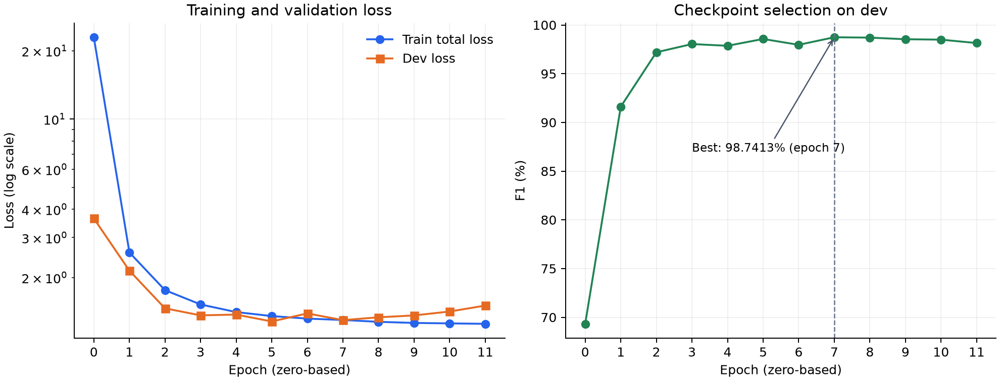

# PAP_NER · PhoBERT-v2 + CRF + Hierarchical SupCon

Notebook tự chứa mã nguồn, log và checkpoint của lần huấn luyện **`vinai/phobert-base-v2` + CRF + Hierarchical Supervised Contrastive Learning** cho nhận dạng thực thể tiếng Việt trên PAP_NER.

Lần chạy được thực hiện trên **Vast.ai / RTX 3090 24 GB** ngày **16/10/2026**. Notebook gốc được giữ nguyên từng byte; repo kèm hướng dẫn mở notebook trên Kaggle. **Chưa chạy kiểm chứng notebook trên Kaggle.**

[Notebook](notebooks/baselineHierarchicalSupCon_PhoBERTv2_Vast_RTX3090.ipynb) · [Model 539 MB](https://github.com/Tin60giay/papner-phobert-v2-crf-hsupcon/releases/download/v1.0.0/best_model.pt) · [Log huấn luyện](logs/train.log) · [Báo cáo](reports/experiment.md)

## Dự đoán lại trên test dedup 70/15/15 — 18/10/2026

Đã bổ sung notebook **chỉ suy luận, không train lại**, dùng chính checkpoint `v1.0.0`:

- **[Xem notebook đã chạy, có dự đoán, bảng điểm và ảnh](notebooks/PAPNER_HSupCon_Predict_Test_Executed_CPU.ipynb)**.
- [Notebook sạch để Import → Run All trên Kaggle](notebooks/PAPNER_HSupCon_Predict_Test_Kaggle.ipynb).
- [Kết quả đầy đủ, thông tin môi trường và kiểm chứng](reports/dedup_test_2026-10-18/README.md).
- [Tải ZIP dự đoán + bảng điểm + biểu đồ](artifacts/papner_hsupcon_dedup_test_2026-10-18.zip).

Lượt này chạy bằng **Jupyter kernel trên CPU máy Windows cục bộ**, không phải Kaggle
hoặc RTX 3090; không phải một lượt huấn luyện mới. Dùng test của
[`levandai1704/PAP_NER_dedup_70_15_15`](https://huggingface.co/datasets/levandai1704/PAP_NER_dedup_70_15_15),
revision `e4af303d22f878e5827c94861f50f747a6b3ed45`: **5.162 câu, 117.462 token**,
không mất token và không có câu phải chia đoạn.

| Chỉ số tính lại bằng `nervaluate==1.2.1` | Giá trị |
| --- | ---: |
| Strict entity Micro-F1 | **98.3815%** |
| Strict entity Macro-F1 | **98.0372%** |
| BIO token accuracy | **99.7140%** |

Notebook mới khắc phục cách đọc API `nervaluate` của cell đánh giá, nạp đủ checkpoint
bằng `strict=True`, không đưa nhãn thật vào model khi dự đoán và xuất cả nhãn thô.
Các class model/CRF/SupCon và encoder từ notebook gốc được giữ nguyên.
**Chưa thực thi notebook mới trên hạ tầng Kaggle**; bản Kaggle có hướng dẫn bật Internet/GPU.

Các mục về lần train RTX 3090, log, lỗi notebook gốc và test 10.278 câu bên dưới
được giữ lại làm hồ sơ lịch sử. **Không so sánh trực tiếp điểm mới với 99.52% trong log cũ**:
đó là tập test khác và bộ chấm CoNLL khác. Notebook train gốc và checkpoint không bị sửa.

## Cấu trúc repository

```text
notebooks/   Notebook gốc tự chứa code train/loss/test/inference
logs/        train.log và runner.log nguyên bản
reports/     Cấu hình, lịch sử theo epoch, metrics và biểu đồ từ log
artifacts/   Hướng dẫn tải checkpoint, manifest và SHA-256
```

Trọng số `best_model.pt` được lưu trong [GitHub Releases](https://github.com/Tin60giay/papner-phobert-v2-crf-hsupcon/releases/tag/v1.0.0), không nằm trong lịch sử Git.

## Mô hình và dữ liệu

| Thành phần | Cấu hình |
| --- | --- |
| Encoder | [`vinai/phobert-base-v2`](https://huggingface.co/vinai/phobert-base-v2) |
| Head / objective | CRF + Hierarchical SupCon |
| Nhãn | `O`, `B/I-CQ`, `B/I-ĐT`, `B/I-VBPL`, `B/I-NG`, `B/I-SL` |
| Train / dev | [`levandai1704/PAP_NER_dedup_70_15_15`](https://huggingface.co/datasets/levandai1704/PAP_NER_dedup_70_15_15) |
| Revision train/dev | `e4af303d22f878e5827c94861f50f747a6b3ed45` |
| Test | [`Leekien0108/PAP_NER`](https://huggingface.co/datasets/Leekien0108/PAP_NER), 10,278 câu |
| Tải test | Sau huấn luyện; revision được lấy tại thời điểm chạy, chưa được ghi trong log đã xuất |

Tên tập train/dev có `dedup_70_15_15`, nhưng test của lần chạy này lấy từ **repo khác**. Repo này chưa kiểm chứng overlap giữa các split; không coi tên dataset là bằng chứng test độc lập.

## Kết quả của lần chạy

| Chỉ số | Giá trị |
| --- | ---: |
| Dev BIO token macro-F1 tốt nhất | **98.7413%** |
| Best epoch (đếm từ 0) | **7** |
| Epoch đã hoàn tất / tối đa | **12 / 20** |
| Test entity precision | **99.38%** |
| Test entity recall | **99.66%** |
| Test entity micro-F1 | **99.52%** |
| Test BIO token accuracy | **99.92%** |

Nguồn: [train.log](logs/train.log). Chỉ số test entity dùng bộ chấm CoNLL đi kèm notebook; không phải bảng Strict/Partial/Entity Type/Exact của `nervaluate`. Các giá trị test giữ nguyên độ làm tròn trong log. Đây là **một seed**; không suy ra độ lệch chuẩn hoặc so sánh trực tiếp với paper/repo khác.



### Trạng thái thực thi

Huấn luyện, lưu checkpoint tốt nhất và đánh giá test đã hoàn tất. Notebook sau đó dừng ở cell **Bước 7: Đánh giá cho paper** với `TypeError: string indices must be integers, not 'str'` khi đọc kết quả của `nervaluate==1.2.1`.

Bảng bốn tiêu chí của cell này **chưa được tạo thành công**. Cell dự đoán ví dụ nằm sau đó cũng chưa được chạy trong lần thực thi này. Lỗi được giữ trong [runner.log](logs/runner.log); code notebook không được sửa trong repo.

## Cấu hình huấn luyện

| Tham số | Giá trị |
| --- | --- |
| Seed / max sequence length | `42` / `256` |
| Train batch / eval batch (train/dev) | `128` / `128` |
| Learning rate encoder / head | `2e-5` / `1e-3` |
| Epoch tối đa / early_stop | `20` / `3.0` |
| Warmup / weight decay | `0.1` / `0.01` |
| Adam epsilon / max grad norm | `1e-6` / `1.0` |
| SupCon λ / temperature / α | `0.3` / `0.07` / `0.3` |
| Precision / gradient checkpointing | AMP FP16 / bật |
| Workers / gradient accumulation | `2` / `1` |

Cấu hình đầy đủ: [training-config.json](reports/training-config.json). Test có DataLoader riêng; giá trị `eval_batch_size=128` trong bảng chỉ mô tả train/dev.

## Mở trên Kaggle

1. Tạo Kaggle Notebook và dùng **Import Notebook → Upload** với [file notebook](notebooks/baselineHierarchicalSupCon_PhoBERTv2_Vast_RTX3090.ipynb).
2. Bật **GPU** và **Internet** để cài thư viện, tải encoder cùng các split Hugging Face.
3. Đọc cấu hình trước khi chạy: batch 128 đã được dùng trên RTX 3090 24 GB; bộ nhớ GPU của phiên Kaggle có thể khác.
4. Chạy lần lượt các cell. Ngoài Vast, code tự chọn thư mục con `phobertv2_hsupcon` dưới thư mục hiện hành; trong phiên Kaggle thông thường đó là `/kaggle/working/phobertv2_hsupcon`.
5. Log/checkpoint nằm trong `outputs/phobertv2_crf_hierarchical_supcon_vast_3090/` bên dưới thư mục trên. Tên có `vast_3090` được giữ nguyên từ notebook gốc.

Không có link Kaggle công khai được tạo trong repo này. Notebook đang lưu đúng bản đã chạy trên Vast, chưa chuyển đổi hay chỉnh hyperparameter riêng cho Kaggle. Lỗi Bước 7 nêu trên vẫn được giữ nguyên.

## Tải model và log

```bash
git clone https://github.com/Tin60giay/papner-phobert-v2-crf-hsupcon.git
cd papner-phobert-v2-crf-hsupcon
gh release download v1.0.0 --pattern best_model.pt --dir artifacts
```

Hoặc tải trực tiếp [best_model.pt](https://github.com/Tin60giay/papner-phobert-v2-crf-hsupcon/releases/download/v1.0.0/best_model.pt). Checkpoint gồm `model`, `classes`, `args`; dùng class `PhoBertV2Crf` và logic nạp checkpoint trong notebook. Tokenizer/config nền lấy từ `vinai/phobert-base-v2`.

SHA-256 model: `449743cbb5b89ab8860d46875577a170600208a00120150772b799cfbd351bab`. Xem [manifest](artifacts/manifest.json) và [checksums](artifacts/SHA256SUMS.txt).

## Nguồn và ghi nhận

- Mã notebook ghi nguồn các hàm/class từ `PhoBERT-Legal-NER/vphoberttagger`; phần CRF/SupCon được giữ trong notebook.
- Encoder và dữ liệu do các tác giả ở các trang Hugging Face liên kết bên trên cung cấp.
- Cách bố trí notebook, artifacts và báo cáo tham khảo [papner-phobert-v2-crf](https://github.com/nobody-nothing-nowhere-just-kurumi/papner-phobert-v2-crf). Không sao chép số liệu của repo đó vào kết quả lần chạy này.
- Repo không tự gán giấy phép mới cho mã nguồn hoặc dữ liệu của bên thứ ba; xem điều khoản tại nguồn tương ứng khi sử dụng lại.
