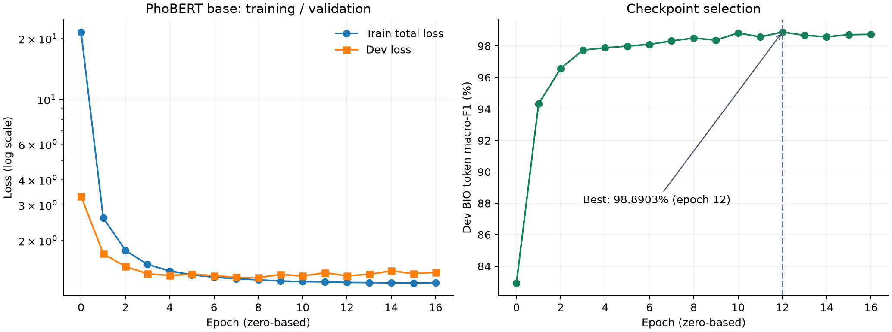
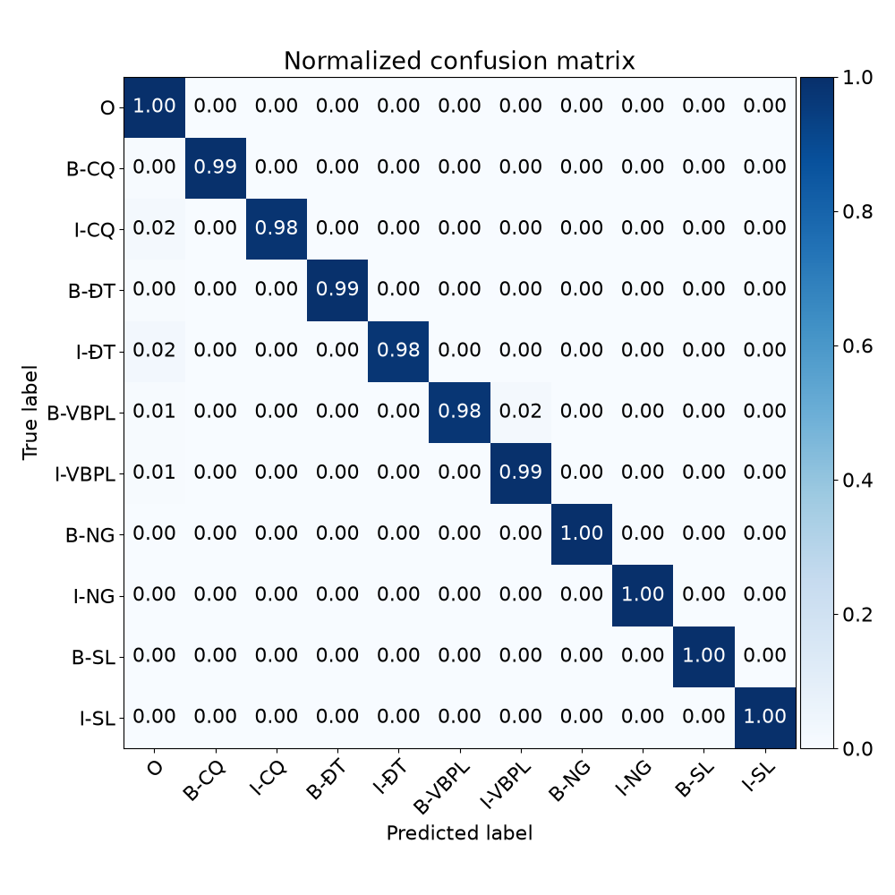

# PhoBERT + CRF + Hierarchical SupCon · 23/10/2026

Lần huấn luyện `vinai/phobert-base` trên Vast.ai / RTX 3090 24 GB, seed 42. Thay backbone của notebook v2 và đổi sang tập test dedup **5.162 câu**; giữ nguyên tham số huấn luyện. Notebook v2 và artifacts của các lần trước được giữ nguyên.

[Notebook](notebooks/baselineHierarchicalSupCon_PhoBERTbase_Vast_RTX3090.ipynb) · [Code model/trainer](code/model_and_trainer.py) · [Train log](logs/train.log) · [Log toàn bộ tiến độ](logs/live.log) · [Kết quả JSON](reports/metrics.json) · [Model](artifacts/README.md)

## Kết quả từ lần chạy

| Chỉ số | Giá trị |
| --- | ---: |
| Epoch hoàn tất / tối đa | **17 / 20** (epoch 0–16) |
| Best epoch, đếm từ 0 | **12** |
| Best dev BIO token macro-F1 | **98,8903%** |
| Test | **5.162 câu / 117.462 token** |
| Test entity precision | **98,21%** |
| Test entity recall | **98,88%** |
| Test entity micro-F1 | **98,55%** |
| Test BIO token accuracy | **99,74%** |

Số liệu lấy từ [train.log](logs/train.log), giữ đúng độ làm tròn trong log. Bộ chấm CoNLL trong notebook gộp chuỗi token trước khi tính entity metrics. Đây **không phải** bảng Strict/Partial/Entity Type/Exact của `nervaluate`, và không so sánh trực tiếp với lần v2 dùng test cũ 10.278 câu.

| Loại | Precision (%) | Recall (%) | F1 (%) | Entity gold |
| --- | ---: | ---: | ---: | ---: |
| CQ | 98.93 | 99.17 | 99.05 | 2,057 |
| NG | 99.92 | 99.84 | 99.88 | 1,227 |
| SL | 99.00 | 100.00 | 99.50 | 201 |
| VBPL | 93.77 | 96.46 | 95.10 | 610 |
| ĐT | 97.77 | 98.63 | 98.20 | 2,284 |





## Dữ liệu và cấu hình

Train **24.089 câu**, dev **5.162 câu**, test **5.162 câu** lấy từ [levandai1704/PAP_NER_dedup_70_15_15](https://huggingface.co/datasets/levandai1704/PAP_NER_dedup_70_15_15), cùng revision `e4af303d22f878e5827c94861f50f747a6b3ed45`. Test là `test_data_dedup_70_15_15.txt`, được tải sau train và kiểm tra đủ 5.162 câu. Hash tại [manifest](artifacts/manifest.json).

Train batch/eval dev batch **128/128**, sequence length **256**, encoder LR **2e-5**, classifier LR **1e-3**, FP16, gradient checkpointing, SupCon λ/temperature/α **0.3/0.07/0.3**. Cấu hình lấy trực tiếp từ arguments trong log: [training-config.json](reports/training-config.json). Test dùng DataLoader riêng.

20 là epoch tối đa. Code gốc kiểm tra `cumulative_early_steps > early_stop`, với `early_stop=3.0`; sau best epoch 12, epoch 13–16 không cải thiện nên dừng trước epoch 17. Lịch sử đủ 17 lượt nằm trong [history.csv](reports/history.csv).

## Trạng thái thực thi và lỗi báo cáo

**Train, lưu `best_model.pt` và lượt test đã hoàn tất.** Tiếp theo cell Bước 7 tạo bảng paper dừng ở `overall[scenario]` với:

```text
TypeError: string indices must be integers, not 'str'
```

Cell cũ dùng `overall, per_type, _, _ = evaluator.evaluate()`. `nervaluate==1.2.1` trả dictionary, nên phép unpack gán các tên khóa dạng string thay vì các bảng metric. Truy cập string bằng khóa `scenario` gây lỗi. Lỗi nằm ở xử lý kết quả báo cáo, sau khi train/test và checkpoint đã lưu. Xem [runner.log](logs/runner.log) và [live.log](logs/live.log).

Cell báo cáo giữ nguyên theo notebook gốc; chưa sửa API, chưa tạo thành công bảng bốn tiêu chí. Cell inference ví dụ sau đó chưa chạy. **Notebook exit code là 1**; không ghi nhận toàn bộ notebook thành công. `nbconvert` không xuất notebook kết quả khi cell bị lỗi, nên repo lưu notebook đầu vào thực tế cùng các log, không dựng lại output rồi gọi là notebook đã thực thi.

## Chạy lại và xem tiến độ

Đặt [notebook](notebooks/baselineHierarchicalSupCon_PhoBERTbase_Vast_RTX3090.ipynb) và [launcher](code/launch_phobert_base_20261023.sh) vào `/workspace` trên máy Vast có PyTorch CUDA, tmux và Jupyter; chạy `bash /workspace/launch_phobert_base_20261023.sh`. Phiên `phobert_base_20261023` chạy tách khỏi máy cá nhân. Kết nối Hugging Face trực tiếp được dùng sau khi mirror lỗi metadata.

```bash
tmux attach -t phobert_base_20261023
```

[model_and_trainer.py](code/model_and_trainer.py) là bản xuất nguyên code cell định nghĩa model/trainer; quy trình cài thư viện, tải dữ liệu, train và test đầy đủ nằm trong notebook. Tên class nội bộ `PhoBertV2Crf` được giữ nguyên, nhưng backbone thực tế là **`vinai/phobert-base`**, như arguments và checkpoint ghi nhận. Script [watch_notebook_progress.py](code/watch_notebook_progress.py) chỉ đọc tiến độ kernel; không tham gia huấn luyện.

## Tái lập

Đây là một seed, chưa kiểm chứng chạy trên Kaggle. [requirements.txt](requirements.txt) là danh sách cài đặt trong notebook; [runtime-versions.json](reports/runtime-versions.json) ghi các phiên bản quan sát được. Backbone tải revision hiện tại lúc chạy, không pin trong notebook; revision cache đã quan sát được lưu trong manifest. Báo cáo này không thực hiện thêm kiểm tra overlap giữa các split.

Báo cáo và biểu đồ được trích từ log sau lần chạy; không chạy lại train hoặc sửa notebook khi đóng gói. Nguồn code và giấy phép bên thứ ba theo [README repository](../../README.md).
