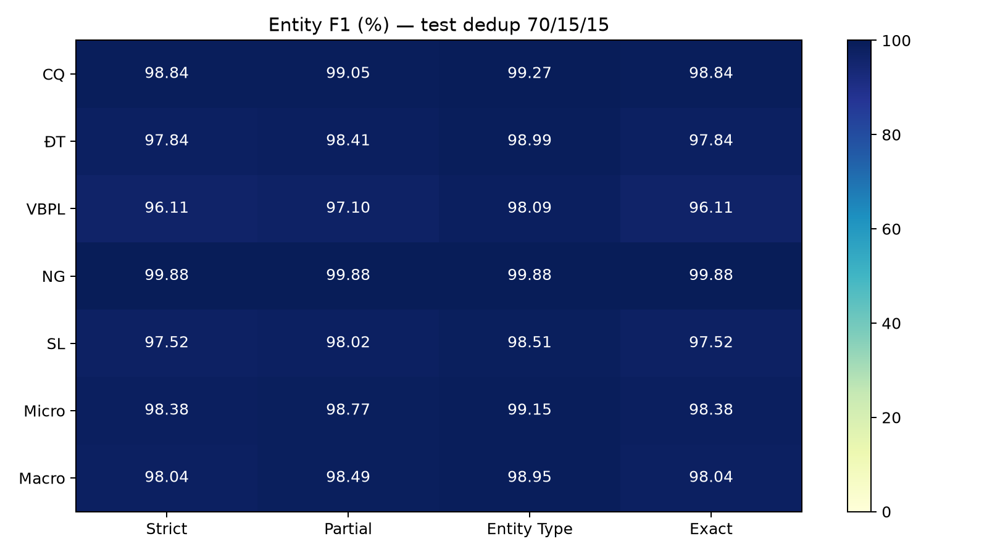
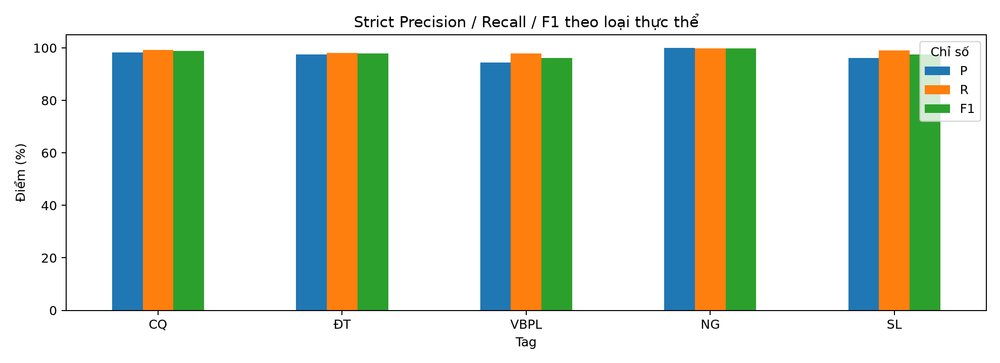
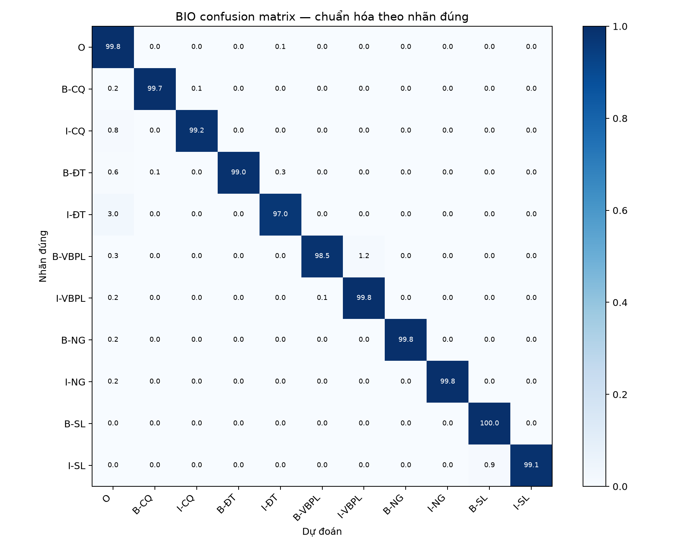

# Đánh giá lại checkpoint trên test dedup — 18/10/2026

## Xem notebook

- [Notebook đã thực thi: có output từng cell và 3 biểu đồ nhúng](../../notebooks/PAPNER_HSupCon_Predict_Test_Executed_CPU.ipynb).
- [Notebook để chạy mới trên Kaggle](../../notebooks/PAPNER_HSupCon_Predict_Test_Kaggle.ipynb).
- [ZIP kết quả](../../artifacts/papner_hsupcon_dedup_test_2026-10-18.zip).

Đây là **inference từ checkpoint cũ, không train lại**. Notebook có output được chạy
trực tiếp qua Jupyter kernel trên Windows cục bộ, CPU AMD Ryzen 7 7840HS, không dùng GPU.
Python 3.12.14, PyTorch 2.6.0+cpu, Transformers 4.44.2, batch inference 32, FP32.
Chưa chạy xác minh trên máy chủ Kaggle; bản Kaggle giữ outputs trống để chạy mới.

## Nguồn và tính tái lập

- Model: `vinai/phobert-base-v2` + Linear + CRF, đã train với Hierarchical SupCon.
- Checkpoint: [GitHub Releases v1.0.0](https://github.com/Tin60giay/papner-phobert-v2-crf-hsupcon/releases/tag/v1.0.0), không thay đổi trọng số.
- SHA-256 checkpoint: `449743cbb5b89ab8860d46875577a170600208a00120150772b799cfbd351bab`.
- Các định nghĩa model/encoder trích nguyên từ notebook nguồn, commit
  `7ef6d0c28a65c96ea522035b74776065c151058e`; không chạy lại cell train hoặc test cũ.
- Config/tokenizer `vinai/phobert-base-v2` revision `86cd7fd4c148980922ac11a2cf5e257f2ba639e1`.
- Dataset: [levandai1704/PAP_NER_dedup_70_15_15](https://huggingface.co/datasets/levandai1704/PAP_NER_dedup_70_15_15).
- Revision dataset: `e4af303d22f878e5827c94861f50f747a6b3ed45`.
- File: `test_data_dedup_70_15_15.txt`.
- SHA-256 test: `efdc66408ba71099549e301842844556d783b9eaff131c202666d5bd1c2a008d`.

Đọc đúng nhãn ở **cột 4** của file nguồn 5 cột. Giữ nguyên thứ tự câu/token và gold.
Nạp checkpoint `strict=True`, đủ cả projection head. Khi inference không truyền labels
vào model, không tính supervised loss. Nhãn được CRF giải mã FP32 và xuất nguyên trạng,
không tự sửa BIO; manifest ghi cả số chuyển BIO không hợp lệ.

## Kết quả

| Chỉ số | Giá trị |
| --- | ---: |
| Số câu test | 5.162 |
| Số token | 117.462 |
| Độ phủ token | 100% |
| Câu cần chia đoạn | 0 |
| Strict entity precision (Micro) | 97.9506% |
| Strict entity recall (Micro) | 98.8163% |
| Strict entity Micro-F1 | 98.3815% |
| Strict entity Macro-F1 | 98.0372% |
| BIO token accuracy | 99.7140% |
| Token khác gold | 336 |

Entity metrics dùng `nervaluate==1.2.1`, giữ ranh giới câu. Macro là trung bình
không trọng số trên năm loại CQ/ĐT/VBPL/NG/SL. Token accuracy không phải entity F1.
Xem đủ Strict / Partial / Entity Type / Exact ở [entity_metrics.csv](entity_metrics.csv).

Test cũ trong log repo dùng `Leekien0108/PAP_NER`, 10.278 câu và bộ chấm CoNLL.
Vì vậy không coi 99.52% cũ và 98.3815% mới là hai kết quả trên cùng benchmark.
Không có train lại, tuning trên test hoặc suy ra độ lệch chuẩn từ một checkpoint.

Thời gian trong [run_manifest.json](run_manifest.json) là của **CPU cục bộ**, chỉ
đo vòng inference sau tokenization/warm-up. ms/câu là thời gian chia cho số câu khi
xử lý batch, không phải latency một request batch=1 và không phải benchmark GPU Kaggle.

## Đọc file dự đoán

| File | Nội dung |
| --- | --- |
| [test_predictions.txt](test_predictions.txt) | `TOKEN POS GOLD PRED`, dòng trống phân cách câu |
| [test_predictions_full.conll](test_predictions_full.conll) | 5 cột nguồn giữ nguyên + dự đoán ở cột 6 |
| [test_predictions_tokens.csv](test_predictions_tokens.csv) | Chỉ số câu/token, token, gold, prediction, đúng/sai |
| [test_predictions_sentences.jsonl](test_predictions_sentences.jsonl) | Từng câu cùng toàn bộ gold/pred |
| [token_errors.csv](token_errors.csv) | 336 token dự đoán khác gold |
| [entity_metric_counts.csv](entity_metric_counts.csv) | Số đếm COR/INC/PAR/MIS/SPU/POS/ACT theo loại/tiêu chí |
| [bio_token_metrics.csv](bio_token_metrics.csv) | Classification report cấp nhãn BIO token |
| [checkpoint_training_config.json](checkpoint_training_config.json) | Tham số train cũ trong checkpoint, không phải một lần train mới |
| [validation_report.json](validation_report.json) | Kiểm tra độ phủ, nguyên trạng dữ liệu, metrics từ export, ZIP |
| [notebook_execution_report.json](notebook_execution_report.json) | Bằng chứng thực thi đủ cell bằng Jupyter kernel |

Ví dụ đầu file:

```text
Khi N O O
đến V O O
thực_hiện A O O
```

Hai cột cuối giống nhau nghĩa là nhãn dự đoán khớp gold tại token đó.

## Biểu đồ







## Ghi công dữ liệu

Bản dedup do [levandai1704](https://huggingface.co/datasets/levandai1704/PAP_NER_dedup_70_15_15)
cung cấp, thẻ dữ liệu ghi CC BY 4.0. Dữ liệu gốc PAP_NER của La và cộng sự:
[bài báo PLOS ONE](https://doi.org/10.1371/journal.pone.0353166),
[bản PAP_NER nguồn](https://huggingface.co/datasets/Leekien0108/PAP_NER).
Phép chia dedup khác các split gốc; không diễn giải điểm này là tái lập điểm bài báo.
